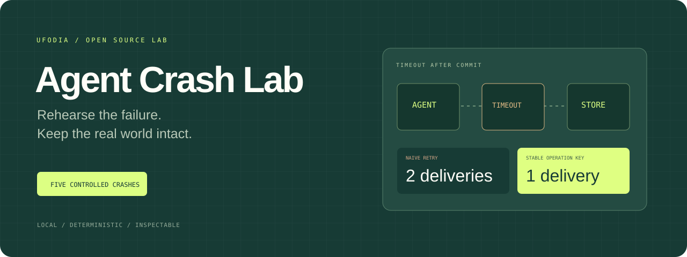
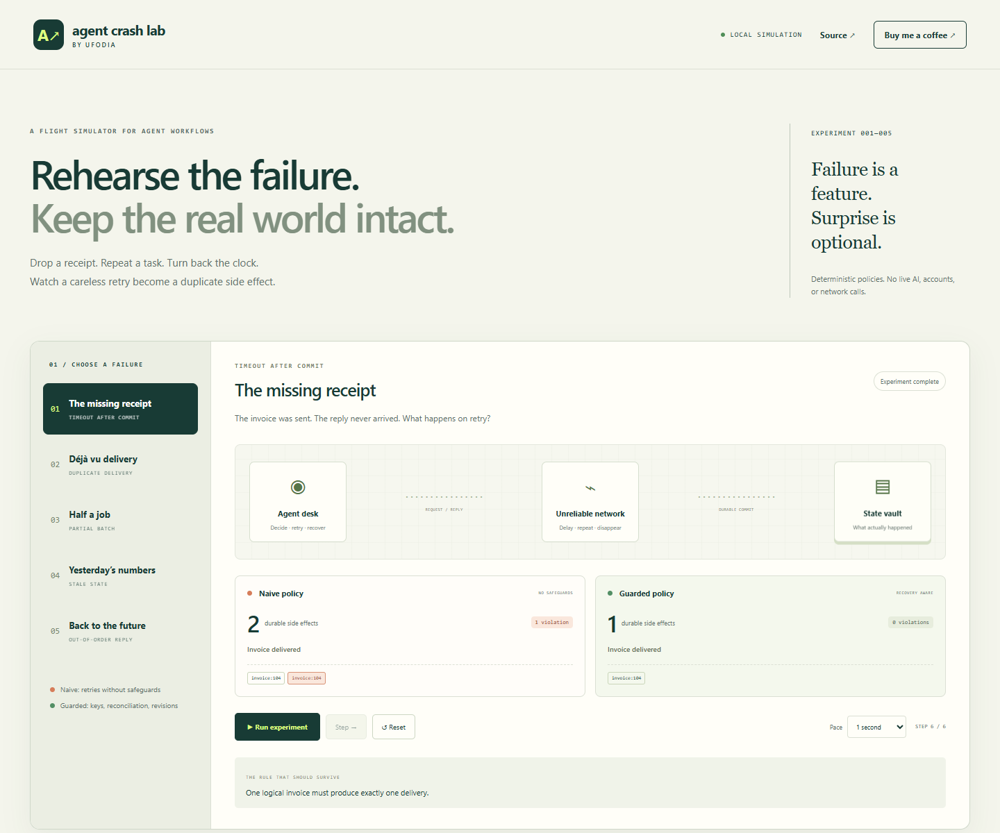

<p align="center"></p>

<p align="center"><strong>A flight simulator for action-taking AI workflows.</strong><br>Lose a receipt. Repeat a task. Crash halfway through. Inspect what really committed.</p>

<p align="center"><a href="LICENSE">MIT · Ufodia</a> &nbsp; / &nbsp; TypeScript &nbsp; / &nbsp; Local simulation &nbsp; / &nbsp; No API key</p>
<p align="center"><a href="https://buymeacoffee.com/ufodia"></a></p>


**[Open the live app ↗](https://agent-crash-lab-lyart.vercel.app/)** · [Deployment guide](docs/DEPLOYMENT.md)

## A retry is not always a recovery

An invoice can be delivered even when its acknowledgment never arrives. Retrying blindly creates a second delivery. A clean-looking final message hides the mistake.

Agent Crash Lab puts durable state beside an event timeline. Compare a deliberately naive policy with a guarded policy, one event at a time. Every built-in run is deterministic: these are executable demonstrations of recovery patterns, **not live LLM agents or a production safety certificate**.



## Start in one minute

Install **Node.js 24 LTS** and npm, then:

```sh
git clone https://github.com/ufodia/agent-crash-lab.git
cd agent-crash-lab
npm ci
npm run dev
```

Open the local URL printed by Vite, select **The missing receipt**, and click **Run experiment**. The naive policy commits two deliveries; the guarded policy returns the existing delivery. Nothing is sent to a real account.

## Five ways to break a workflow

| Experiment | Injected failure | Pattern you can inspect |
| --- | --- | --- |
| The missing receipt | Timeout after the server commits | Stable idempotency key |
| Déjà vu delivery | The same task arrives twice | Logical operation deduplication |
| Half a job | Crash after two items in a three-item batch | Durable reconciliation |
| Yesterday’s numbers | Another writer updates state after a read | Revision preconditions and rebasing |
| Back to the future | An old response arrives after a new response | Monotonic revision guard |

The ledger counts **all successful durable effects**, including a colleague's update in the stale-state scenario. A violation is a broken scenario invariant; it is not a security or model-quality score.

## Use it your way

- **Run, pause, step, reset.** Compare policies at the same event position. Shorter timelines hold their final state while the longer one finishes.
- **Read the ledger.** Duplicate operation IDs are highlighted. The displayed state exposes lost updates and response regressions.
- **Export traces.** The app downloads one JSON trace per policy. Your browser may ask permission for multiple downloads.
- **Replay your own evidence.** Import a trace matching the [trace contract](docs/formats.md). Imported evidence is displayed alone, and its author-supplied counts are clearly labeled.
- **Automate an experiment.** Use the CLI or import the pure engine into a TypeScript adapter.

```sh
npm run simulate -- timeout-after-commit safe
npm run simulate -- partial-batch naive batch-trace.json
npm run simulate -- --replay examples/timeout-safe.json
```

The CLI refuses to overwrite an existing output file. See [the engine reference](docs/architecture.md) to integrate your own runner.

## Privacy and boundaries

The application runs locally with no analytics, remote fonts, telemetry, model calls, or account integrations. Traces are held in memory; refresh clears them. Download only evidence you intend to keep. Repository and support links leave the app only when you choose them.

Built-in experiments use synthetic data and explicit assumptions. An imported trace is structurally validated, not independently attested. Passing a simulated scenario does not prove a real agent is safe under other failures. See [limitations](docs/limitations.md).

## Develop and verify

```sh
npm run typecheck
npm test
npm run build
npm run preview
```

Tests cover duplicate commits, partial-batch recovery, stale writes, out-of-order replies, deterministic replay, isolated snapshots, and malformed imports. GitHub Actions runs type checking, tests, and production builds; it does not deploy the app.

## Documentation

| Guide | What you will find |
| --- | --- |
| [User guide](docs/user-guide.md) | Walk through your first experiment and replay |
| [Architecture](docs/architecture.md) | Engine API, state model, and adapter integration |
| [Trace format](docs/formats.md) | Complete import/export contract and validation |
| [Limitations](docs/limitations.md) | Assumptions, trust boundaries, and intended use |
| [Contributing](CONTRIBUTING.md) | Development and review process |
| [Security](SECURITY.md) | Private vulnerability reporting |
| [Changelog](CHANGELOG.md) | Versioned changes |

## More from ufodia

Explore more open-source tools by [ufodia](https://github.com/ufodia):

- [Sheet Sentry](https://github.com/ufodia/sheet-sentry) — review spreadsheet changes, including edits made by AI tools.
- [CutOnce](https://github.com/ufodia/cutonce) — plan rectangular parts on irregular material offcuts in your browser.
- [Browse all repositories](https://github.com/ufodia?tab=repositories).

## Keep the lab open

If an experiment helped you catch a risky retry or explain a failure to your team, [buy Ufodia a coffee](https://buymeacoffee.com/ufodia). Contributions fund maintenance, clearer examples, and new failure scenarios. You can also contribute a small reproducible case or improve the docs.

Licensed under the [MIT License](LICENSE). Copyright © 2026 **Ufodia**.

## Browser checks

The real workbench flow is covered by [Playwright browser tests](docs/BROWSER_TESTS.md), including local exports and mobile layout. Run `npm run test:browser` after installing Chromium.
